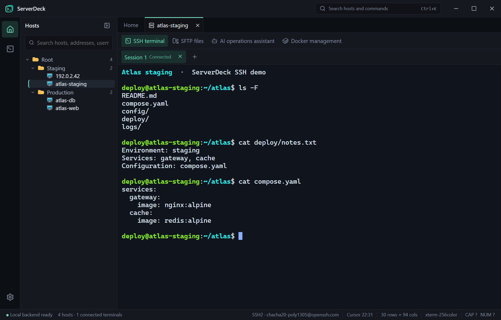

# ServerDeck

[English](README.md) | [简体中文](README.zh-CN.md)

ServerDeck 是面向开发者和运维人员的本地优先服务器工作台，基于 Rust、Tauri 2、Vue 3 和 TypeScript 构建。通过 SSH/SFTP 将终端、文件、Docker 和 AI 运维集中在同一主机工作区，无需云端账号或远端 Agent。



## 功能

- **主机管理**：多级文件夹、搜索、拖动、复制、连接测试、受限 OpenSSH Config 预览导入；密码和私钥交给系统凭据库。
- **终端**：本地与 SSH Shell、多会话、分屏、查找、快捷键、原生剪贴板、网址打开、rz 上传及向当前 Shell 目录拖放文件/文件夹；支持跳板和代理。
- **文件管理**：本地/远程双栏 SFTP、目录操作、后台传输、冲突处理、SHA-256 校验、确认式 sudo 用户切换、独立文本编辑窗口和 Windows 系统应用编辑。
- **Docker 插件**：容器、镜像、Compose 项目、只读启动配置与环境变量、日志、Shell、确认式容器操作，以及镜像导入、导出和远程传输。
- **AI 运维助手**：匹配登记主机，按问题采集并脱敏，通过模型流式回答；预览并按审批模式执行固定目标计划、局部文本修改和单文件传输，执行后复查。
- **模型与插件管理**：远程 OpenAI 兼容模型、本地 Codex/Claude Code 来源；本地插件包安装、权限、配置、启停和卸载，以及可下载的独立开发包。
- **桌面工作区**：主机标签、全局搜索、深浅主题、中英文、字号与快捷键设置、数据目录迁移和安全退出。

功能边界见[产品基线](docs/product/PRD.md)，操作见[使用说明](https://ops.hiboot.cn/docs/)。

## 平台与版本

应用版本以 [Cargo.toml](Cargo.toml) 的 `[workspace.package].version` 为唯一来源。SDK、插件包和数据格式分别管理版本。

Windows x64 是首要发布验收平台；macOS/Linux 客户端及其他架构须分别完成原生验收。界面支持简体中文和 English。源码可构建不等于安装包或所有平台已经通过发布验收，发布前按[检查表](docs/release/RELEASE_CHECKLIST.md)逐项确认。

## 开始使用

安装与日常操作统一见[官网用户文档](https://ops.hiboot.cn/docs/)，首次使用可阅读[安装与升级](https://ops.hiboot.cn/docs/installation.html)和[连接第一台主机](https://ops.hiboot.cn/docs/quickstart.html)。插件作者从[开发者中心](https://ops.hiboot.cn/developers/)开始。

## 开发与构建

需要 Rust stable 1.94+、Node.js 22.13+、npm 和 `wasm32-unknown-unknown`。Windows 还需 MSVC C++ Build Tools、Windows SDK 和 WebView2。

```powershell
npm ci
rustup target add wasm32-unknown-unknown
npm run plugins:fetch
npm run tauri -- dev
```

`npm run dev` 仅启动浏览器前端，完整功能需要 Tauri/Rust 后端。内置插件独立编译并使用 locked/offline；首次或锁文件变化后先准备依赖。

构建命令、共享 Cargo 目录、磁盘要求和独立开发包验证统一见[开发与验证指南](docs/guides/DEVELOPMENT.md)。应用版本来自 Cargo 工作区，SDK 和插件独立管理版本。

## 测试

按变更范围执行[本地检查](docs/guides/DEVELOPMENT.md#本地检查)和[原生验收](docs/release/NATIVE_VALIDATION.md)。原生测试使用复制到隔离 QA 目录的可执行文件；远程变更须有测试环境授权。这些说明不代表当前候选已经通过发布检查。

## 使用边界

- 系统凭据库不可用时明确失败，不降级为明文；支持 Ed25519/ECDSA 和 RSA 私钥，RSA 认证要求服务器声明支持 SHA-2 签名，不回退 SHA-1。
- 主机密钥必须核验；变更按宿主审批规则授权，不自动提权。
- 文件传输失败后从头重试，不支持断点续传或跨重启恢复。桌面文本编辑上限 2 MiB，助手文本编辑上限 32 KiB；原子替换不保证保留 ACL、扩展属性或硬链接关系。
- 助手任务和对话仅在运行期保留。超时、断线或取消后远端操作可能已经发生，须核对实际结果，不能自动重放变更。
- Windows x64 正式 NSIS 安装版支持带签名和版本校验的应用内更新；插件包没有密码学签名验证，文件摘要不能证明发布者身份。

完整边界见[安全说明](docs/release/SECURITY.md)。

## 文档与许可

[文档导航](docs/README.md)提供研发、架构、插件契约、发布验收与官网使用文档入口；开发要求见 [AGENTS.md](AGENTS.md)。

项目采用 [MIT 许可证](LICENSE)。第三方依赖及许可证见[依赖清单](docs/release/DEPENDENCY_INVENTORY.md)和[第三方声明](docs/release/THIRD_PARTY_NOTICES.txt)。
